<p align="center">
  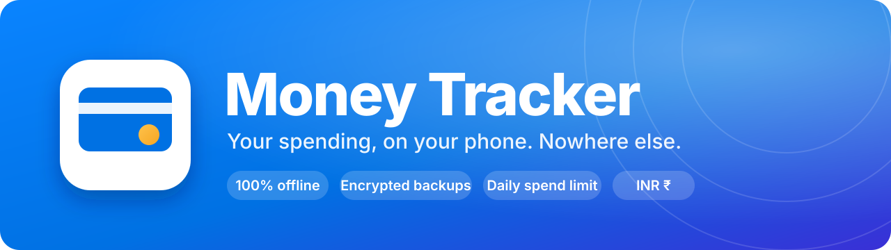
</p>

<p align="center">
  
  
  
  
  
  
  
  
</p>

<p align="center">
  <b>A fast, good-looking money tracker that tells you how much you can spend <i>today</i> and still hit your savings goal.</b><br>
  Built for a small group of friends. No account, no cloud, no ads, no analytics.
</p>

<p align="center">
  <a href="#-a-quick-look">Screenshots</a> ·
  <a href="#-what-it-does">Features</a> ·
  <a href="#-how-the-daily-limit-works">The daily limit</a> ·
  <a href="#-security-and-privacy">Security</a> ·
  <a href="#-build-it">Build</a> ·
  <a href="#-install-and-share">Install</a> ·
  <a href="#-faq">FAQ</a>
</p>

---

## 🎯 Why this exists

Most money apps ask for your bank login, your email and a subscription. This one asks for nothing. You tell it what
you earn and how much you want to keep, and it keeps one number on the home screen: **what you can spend today**.
Everything else (charts, budgets, recurring bills, reminders) exists to make that number honest.

- 🔒 **Private by construction.** There is no internet permission in the app, so there is nowhere for your data to go.
- ⚡ **Fast to use.** A widget, a quick-settings tile and an app-icon shortcut put "add expense" one tap away.
- 🪶 **Light.** Native Kotlin, no heavy libraries: the whole signed APK is about **3 MB**.

## 📸 A quick look

<table>
  <tr>
    <td align="center" width="33%">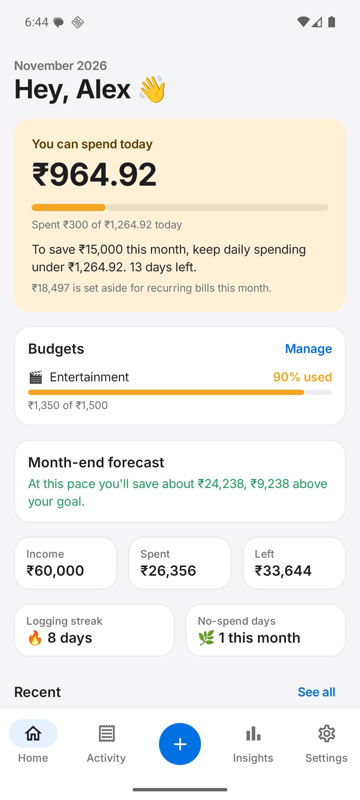<br><sub><b>Today's limit</b><br>what's left to spend, live</sub></td>
    <td align="center" width="33%">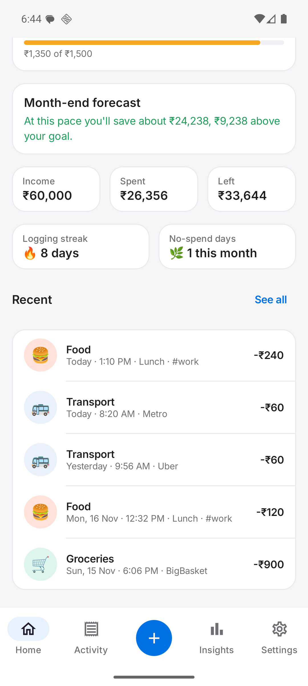<br><sub><b>Budgets, forecast, streaks</b><br>warnings at 80% of a budget</sub></td>
    <td align="center" width="33%">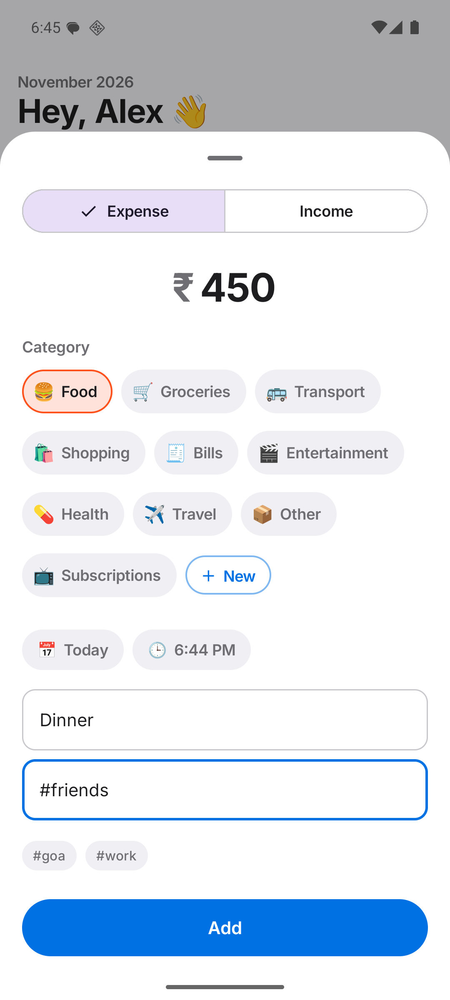<br><sub><b>Add in seconds</b><br>categories, tags, date and time</sub></td>
  </tr>
  <tr>
    <td align="center">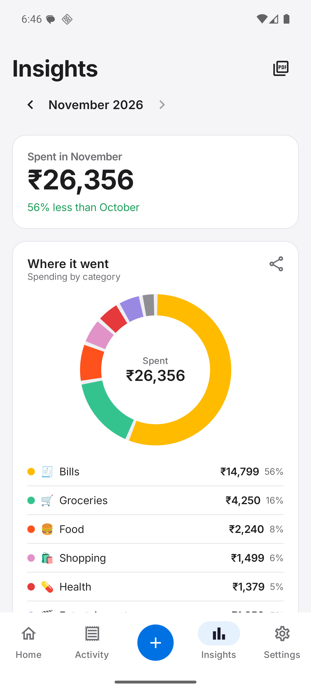<br><sub><b>Where it went</b><br>category breakdown vs last month</sub></td>
    <td align="center">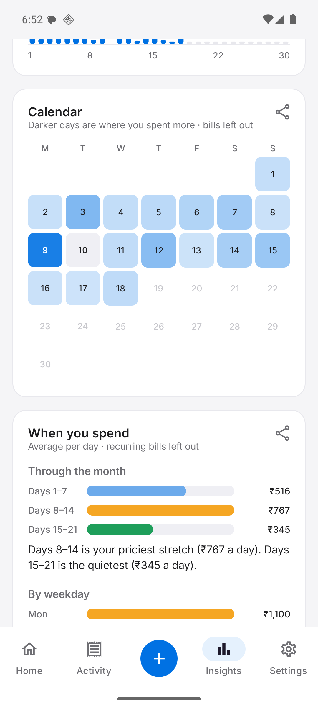<br><sub><b>Calendar heatmap</b><br>darker days = more spent</sub></td>
    <td align="center">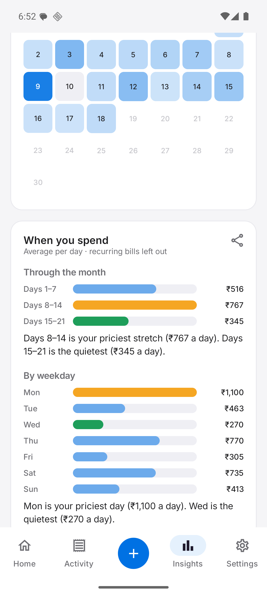<br><sub><b>When you spend</b><br>priciest and quietest stretches</sub></td>
  </tr>
  <tr>
    <td align="center">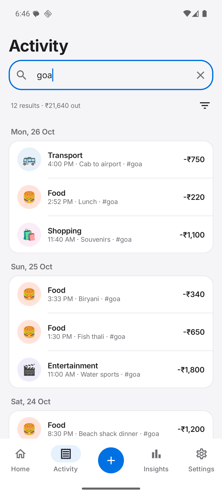<br><sub><b>Search &amp; filter</b><br>text, tag, category, dates, amount</sub></td>
    <td align="center">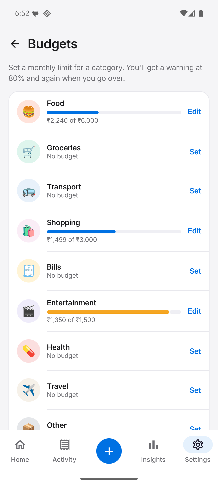<br><sub><b>Category budgets</b><br>a monthly limit per category</sub></td>
    <td align="center">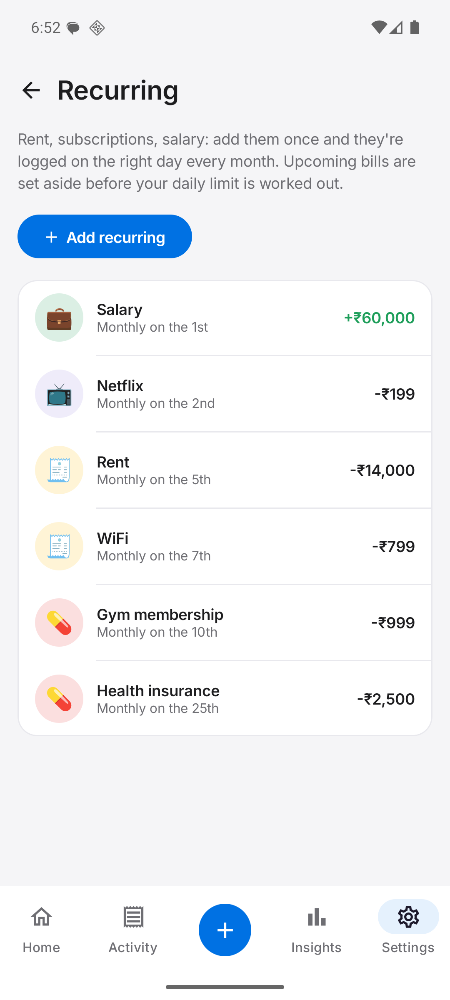<br><sub><b>Recurring</b><br>rent, subscriptions, salary</sub></td>
  </tr>
  <tr>
    <td align="center">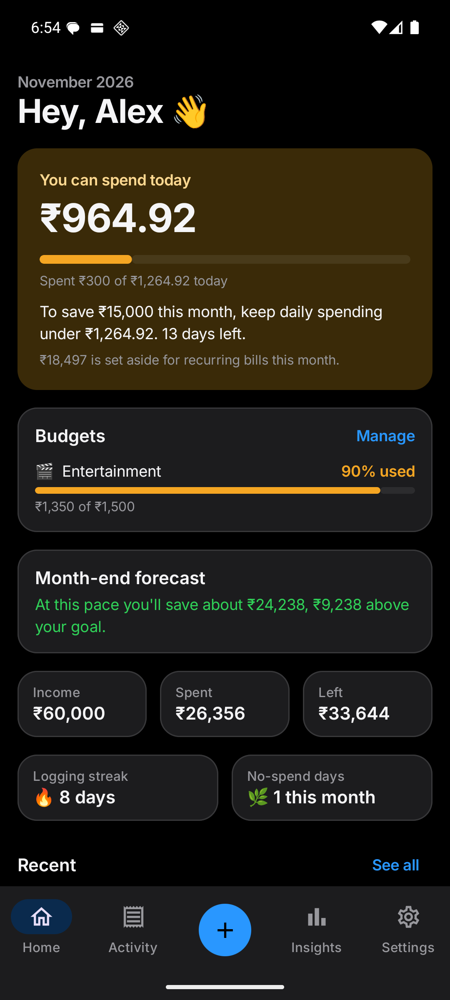<br><sub><b>Dark theme</b><br>system, or your choice in Settings</sub></td>
    <td align="center">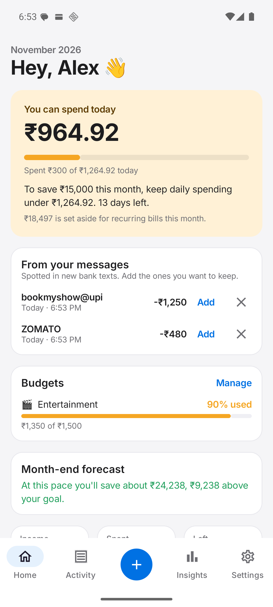<br><sub><b>Bank-text suggestions</b><br>you confirm each one</sub></td>
    <td align="center">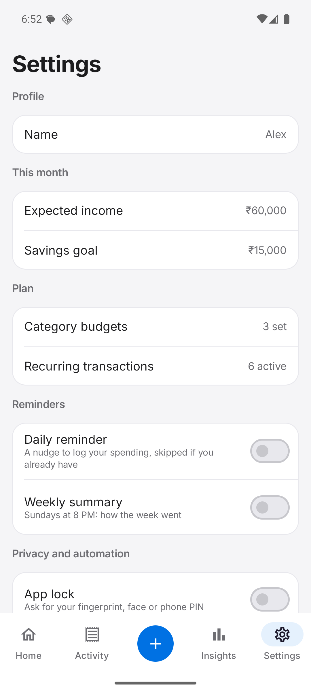<br><sub><b>Settings</b><br>reminders, app lock, backups</sub></td>
  </tr>
</table>

<details>
<summary><b>More: widget, reports, encrypted backup</b></summary>
<br>
<table>
  <tr>
    <td align="center" width="33%">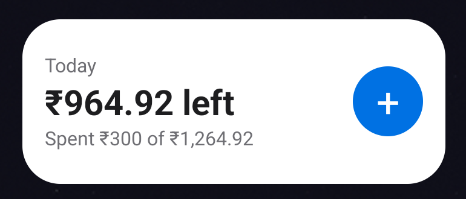<br><sub><b>Home-screen widget</b><br>limit + one-tap add</sub></td>
    <td align="center" width="33%">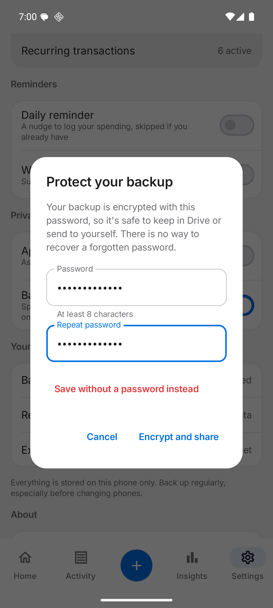<br><sub><b>Encrypted backups</b><br>AES-256-GCM, your password</sub></td>
    <td align="center" width="33%">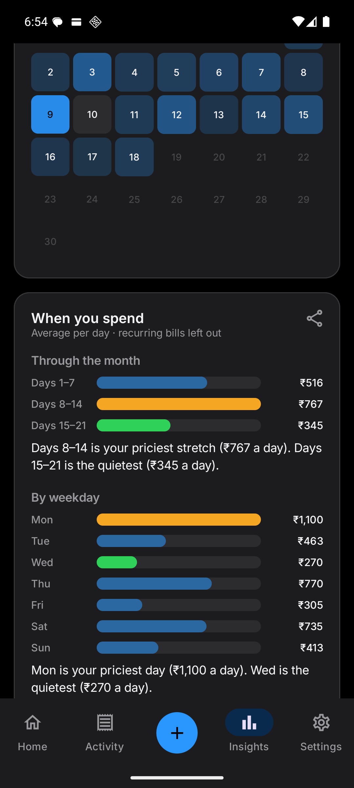<br><sub><b>Insights, dark</b></sub></td>
  </tr>
  <tr>
    <td align="center" colspan="2">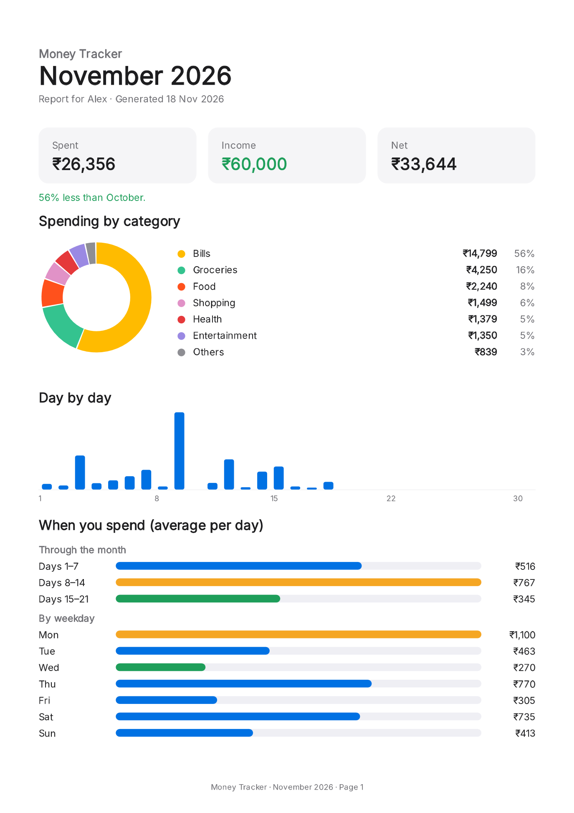<br><sub><b>Monthly PDF report</b><br>summary, charts, patterns, every transaction</sub></td>
    <td align="center">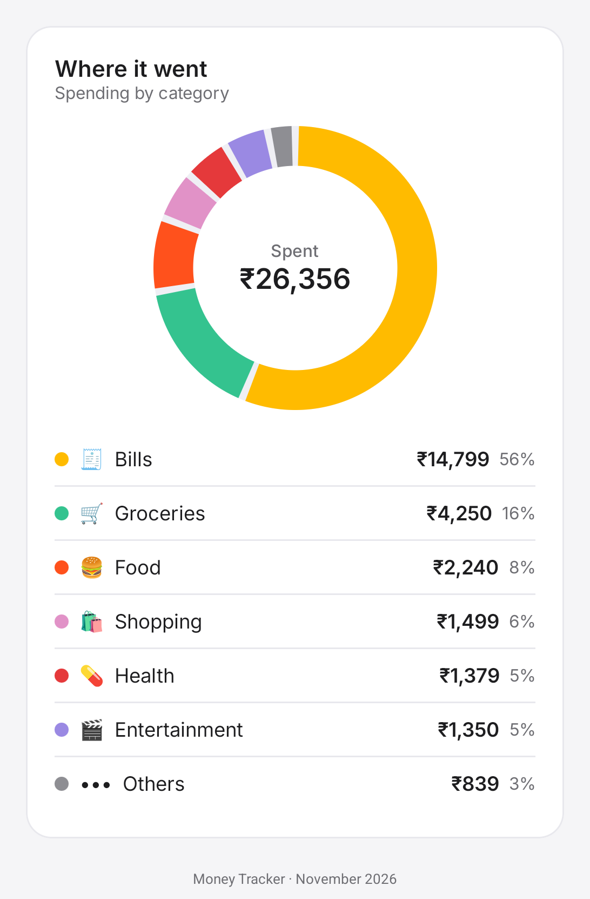<br><sub><b>Share any chart as an image</b></sub></td>
  </tr>
</table>
</details>

## ✨ What it does

### 💸 Spend with a plan
- **A daily spending limit** that recalculates every day from what's left, so one bad day automatically tightens tomorrow ([how it works](#-how-the-daily-limit-works)). It's optional: tap the cross to remove it from Home, and bring it back from the prompt that takes its place.
- **Month-end forecast:** "at this pace you'll save about ₹24,238, ₹9,238 above your goal".
- **Category budgets** with a warning when a purchase pushes you past **80%**, and again when you go over.
- **Recurring transactions** (rent, subscriptions, salary) that log themselves on the right day, catch up if you were away, and are *set aside in advance* so a bill due on the 25th never ambushes you.
- **Streaks:** a logging streak and a count of no-spend days, because small wins help. A day with nothing to log keeps the streak alive with one tap on *Spent nothing today*.

### 📊 Understand where it goes
- Category **donut**, **day-by-day bars** (tap a day), and a **calendar heatmap**.
- **When you spend:** average per day for each stretch of the month and each weekday, with the priciest and quietest called out.
- **Top items** (grouped by what you typed, so "Pizza" ×7 counts together) and **tags** for cross-category totals like a trip.
- Month-over-month comparison and a month switcher.

### ⚡ Log faster
- **Home-screen widget**, **quick-settings tile** and a **launcher shortcut** all open the add sheet directly.
- **Light, dark or system theme**, chosen in Settings → Appearance.
- **Bank-text suggestions:** in your messages app, **Share** a bank text to Money Tracker (or copy it and tap *Settings → Add from a bank text*) and it becomes a suggestion you confirm. The app never reads your messages on its own and has **no SMS permission**.
- **Tags** (`#goa`, `#work`), custom categories with icons and colors, date and time on every record, swipe to delete with undo.

### 🔔 Stay on track
- A **daily reminder** at a time you choose, skipped if you've already logged today.
- A **weekly summary** every Sunday evening.

### 📤 Take your data with you
- **PDF report** per month, **PNG** of any chart, **CSV** of every transaction.
- **Password-protected backup and restore**, so moving to a new phone takes a minute.

### 🔐 Locked down
- **App lock** with your fingerprint, face or phone PIN; amounts kept off the widget and the lock screen (screenshots and screen sharing still work). [Details below.](#-security-and-privacy)

## 🧮 How the daily limit works

The number on the home screen isn't "income ÷ 30". It's the amount that keeps your goal reachable *given everything that
has already happened this month*:

```text
spendable   = income − savings goal − recurring bills (paid and still due)
today's cap = (spendable − day-to-day spending before today) ÷ days left, today included
```

A worked example, using the [demo data](docs/demo) on the 18th of the month:

| | |
|---|---:|
| Income | ₹60,000 |
| Savings goal | − ₹15,000 |
| Recurring bills (₹15,997 paid + ₹2,500 insurance still due) | − ₹18,497 |
| **Spendable for the month** | **₹26,503** |
| Day-to-day spending before today | − ₹10,059 |
| Left for the remaining 13 days | ₹16,444 |
| **Today's cap** (16,444 ÷ 13) | **₹1,264.92** |

Spend ₹300 today and the card shows **₹964.92 left**. Overspend and the app tells you tomorrow's new limit instead of
pretending nothing happened. Recurring bills are kept out of the day-to-day number, so rent landing on the 5th never
makes you "over limit".

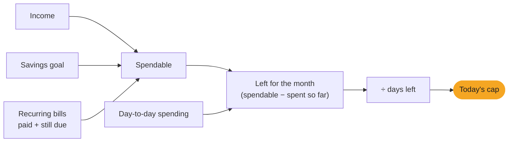

## 🔐 Security and privacy

Your finances are sensitive, so the app is built to keep very little off the phone, protect what stays, and distrust
everything that comes in. The full write-up, including **what it does *not* protect against**, is in
**[SECURITY.md](SECURITY.md)**.

| Threat | Protection |
|---|---|
| Phone left unlocked | App lock (strong biometrics or the phone PIN), re-locks after 30 s |
| Another app, malware | Android sandbox; nothing exported that hands out data; **no internet permission** |
| USB / cloud backup extraction | `allowBackup=false`, empty data-extraction rules, non-debuggable release |
| A backup file leaks | **AES-256-GCM** with a PBKDF2 key (600,000 iterations); tampering is detected |
| A malicious backup file | Size, range and consistency validation; control/RTL characters stripped; atomic restore |
| Forged bank texts | Nothing is read automatically (no SMS permission). A shared text only becomes a suggestion you must confirm; it's sanitised and size-limited, absurd amounts are ignored, and only a hash is kept |
| Spreadsheet formula injection | Dangerous cell prefixes neutralised in CSV exports |
| Tampered APK in the group | Signed release; published certificate fingerprint; a re-signed copy can't read your data |
| Tap-jacking, task hijacking | Obscured-touch filtering, overlay hiding, empty task affinity |
| Compromised dependencies | SHA-256 dependency verification in the build |

> Security is tested, not just claimed: tampered ciphertext, weakened encryption parameters, hostile backups, formula
> injection and spoofed texts all have unit tests.

## 🏗️ How it's built

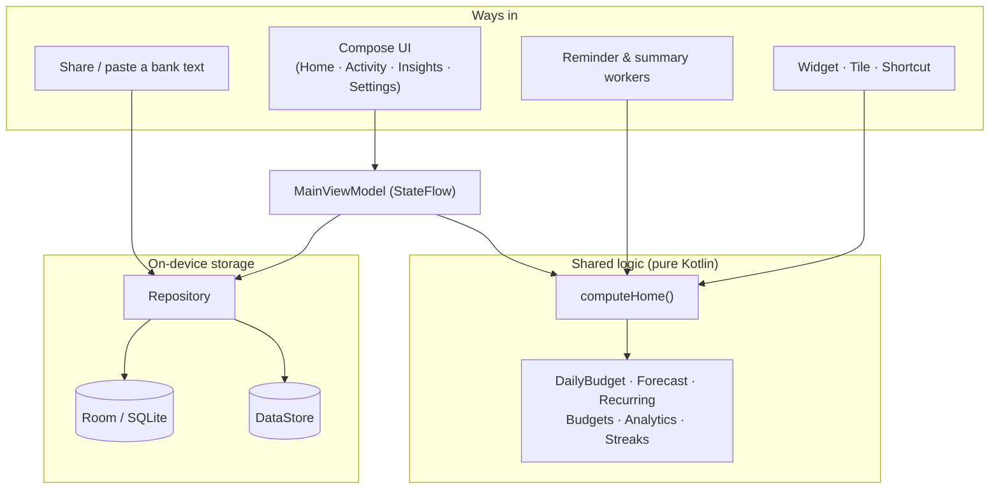

The widget, the notification workers and the screens all call the same pure functions, so the number on the home
screen, in the widget and in a reminder can never disagree.

<details>
<summary><b>Project layout</b></summary>

```text
app/src/main/java/com/akash/moneytracker/
├── MainActivity.kt          single activity; lock screen gate; quick-add intents
├── MainViewModel.kt         state for the screens
├── HomeState.kt             computeHome(): the shared home-screen calculation
├── data/                    Room entities, DAOs, migrations, DataStore, Backup, BackupCrypto
├── domain/                  pure logic: DailyBudget, Forecast, Recurring, Budgets, Analytics, Tags, Streaks…
├── ui/                      Compose screens: home, transactions, analytics, add, settings, components, theme
├── export/                  PDF report (PdfDocument) and share-sheet helpers
├── notify/                  channels, scheduler, daily reminder + weekly summary workers
├── widget/                  home-screen widget and quick-settings tile
├── sms/                     bank-text parser (used by share / paste import)
└── lock/                    app lock (BiometricPrompt) and lock screen
```
</details>

### 🧰 Tech stack

| | |
|---|---|
| Language / UI | Kotlin 2.4 · Jetpack Compose · Material 3 · Navigation Compose |
| Storage | Room 2.8 (schema v4, hand-written migrations, exported schemas) · DataStore |
| Background | WorkManager (self-rescheduling jobs that survive reboots) |
| Security | `androidx.biometric` · `javax.crypto` (AES-GCM, PBKDF2) · Gradle dependency verification |
| Charts | Drawn directly with Compose Canvas: no chart library |
| PDF / images | Android `PdfDocument`, `GraphicsLayer` capture |
| Build | AGP 9.5 · Gradle 9.6 · R8 minify + resource shrinking · `minSdk 26`, `targetSdk 36` |

Money is stored as integer **paise** (never floating point), and every figure is formatted with Indian digit grouping
(₹12,34,567).

## 🚀 Build it

You need Android Studio (for its bundled JDK) and the Android SDK (platform 37, build-tools 36).

```bash
git clone <this repo> && cd moneytracker
./gradlew :app:installDebug          # build and install on a connected phone or emulator
./gradlew :app:testDebugUnitTest     # run the unit tests
./gradlew :app:lintRelease           # static analysis
./gradlew :app:assembleRelease       # signed APK -> app/build/outputs/apk/release/
```

Release signing reads its key from `~/.android/moneytracker-keystore.properties` (never from the repo). Without it
the build falls back to the debug key so it still works for contributors. See [Signing](#-signing).

Want the screenshots' data on your own device? Install the app, then **Settings → Restore from backup** and pick
[`docs/demo/demo-backup.json`](docs/demo/demo-backup.json). It's entirely fictional.

### 🧪 Tests

81 unit tests cover the money maths, the daily limit and forecast, budgets, recurring catch-up, analytics, filters,
tags, streaks, notification timing, the bank-text parser, backups, **and the security behaviour** (encryption, tampering,
hostile files, injection, spoofing). Database migrations were verified by upgrading real installs from every earlier
version.

## 📲 Install and share

The app isn't on the Play Store; it's a signed APK you hand to people you trust.

1. Send them `MoneyTracker-1.3.0.apk`.
2. They open it and allow *"Install unknown apps"* for the app they received it in.
3. **Verify it first** if it came through a chat: compare the certificate fingerprint in [SECURITY.md](SECURITY.md#verify-your-download).
4. Updates install over the old version and keep all data, as long as they're signed with the same key.

### 🔑 Signing

The release key lives **outside** the repo (`~/.android/moneytracker-release.jks`). Back it up somewhere offline: lose
it and nobody can update in place; leak it and anyone could publish "updates" Android would accept.

### 🔒 Optional features and their permissions

Nothing below is asked for until you switch it on.

| Feature | Permission | Notes |
|---|---|---|
| Reminders, weekly summary | Notifications (Android 13+) | |
| Bank-text suggestions | none | You share or paste a text yourself, so the app needs no SMS permission. |
| App lock | none | Uses the phone's own screen lock; the app stores no PIN |
| Widget, tile, shortcut | none | Add the tile from the quick-settings edit panel |

## ❓ FAQ

<details><summary><b>Where is my data stored?</b></summary>
Only in the app's private storage on your phone. There's no server, no account and no network access to send it
anywhere. Android's own backup is switched off on purpose; use <b>Settings → Back up everything</b> instead.
</details>

<details><summary><b>I got a new phone. How do I move my data?</b></summary>
On the old phone: <b>Settings → Back up everything</b>, choose a password, and save the file to Drive or send it to
yourself. On the new phone: install the app, <b>Settings → Restore from backup</b>, pick the file, enter the password.
</details>

<details><summary><b>I forgot my backup password.</b></summary>
It can't be recovered. That is exactly what protects the file if it ever ends up in the wrong hands. Make a new backup
from the app while you still have it.
</details>

<details><summary><b>Play Protect says "App blocked to protect your device".</b></summary>
That message is shown for sideloaded apps that ask for <i>sensitive</i> permissions such as reading SMS. Money Tracker
no longer asks for any (versions before 1.2.1 did, for the bank-text feature). Install <b>1.2.1 or newer</b>. If you
still see Play Protect's generic "unknown app" prompt, that is normal for any app not from the Play Store: choose
<i>More details → Install anyway</i>, and check the certificate fingerprint in <a href="SECURITY.md#verify-your-download">SECURITY.md</a>.
</details>

<details><summary><b>Taps stop working while a screen-dimmer app is on.</b></summary>
To prevent look-alike overlays from hijacking taps, the app ignores touches while another app draws over it. On
Android 12+ it simply hides other apps' overlays; on older versions, pause the overlay app while using Money Tracker.
</details>

<details><summary><b>Does it work in other currencies?</b></summary>
No. It's INR only by design (rupee symbol and Indian digit grouping throughout).
</details>

## 🗺️ Roadmap

- [x] Daily limit, forecast, budgets, recurring, tags, streaks
- [x] Insights, calendar heatmap, PDF / PNG / CSV export
- [x] Widget, tile, shortcut, reminders, weekly summary, bank-text suggestions (share or paste)
- [x] App lock, encrypted backups, hardened imports
- [ ] Multiple accounts / wallets
- [ ] Receipt photos
- [ ] Other currencies

## 🤝 Contributing

Issues and pull requests are welcome. Please keep changes small, add a test for new logic, and run
`./gradlew :app:testDebugUnitTest :app:lintRelease` first. For security issues, **don't open a public issue**: follow
[SECURITY.md](SECURITY.md#reporting-a-vulnerability).

<p align="center"><sub>Made with care for people who'd rather their money stayed their business.</sub></p>
